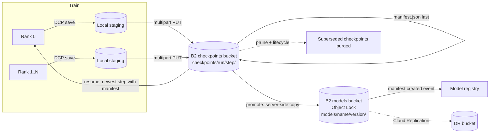

# Checkpoint distributed training to B2 and resume after interruption

Evidence reviewed: 2026-10-14. PyTorch distributed checkpoint (DCP) and Ray Train storage from source review; PyTorch Lightning from documentation; B2 Object Lock, lifecycle, and key documentation; moto-backed tests in the [PyTorch sample](../../applications/pytorch-b2-checkpointed-training/README.md). See [Evidence and validation scope](#evidence-and-validation-scope).

## Workload

Long training runs lose nodes, get preempted, or are restarted on different hardware. Every few minutes or hours each rank writes its part of a checkpoint. After an interruption the job must resume from the newest checkpoint that was fully written, never from a partial one. A few checkpoints are promoted to models that must stay immutable and traceable to the data that produced them.

B2 holds checkpoints and promoted models. Each rank writes its checkpoint shards to local disk first, so training resumes as soon as the local write finishes, and the upload to B2 happens in parallel.

## Data flow



```mermaid
sequenceDiagram
  participant T as Trainer (all ranks)
  participant L as Local staging
  participant B as B2 (S3 API)
  T->>L: dcp.save(state, step N)
  par each rank
    T->>B: PUT shard files (multipart above threshold)
  end
  T->>B: verify sizes and checksums
  T->>B: PUT checkpoints/run/step-N/manifest.json (coordinator, last)
  Note over T,B: interruption
  T->>B: LIST checkpoints/run/
  T->>B: GET newest manifest; GET and verify its files
  T->>T: dcp.load, continue from step N+1
```

## B2 zones

| Zone | Bucket | Prefix | Versioning / lifecycle | Lock | Purpose |
|---|---|---|---|---|---|
| Checkpoints | `<org>-train-checkpoints` | `checkpoints/<run>/step-<step>/` | purge hidden versions after 7 days; optionally hide abandoned runs after 30 days ([example](../../examples/lifecycle-checkpoints.json)) | no | Resumable training state |
| Models | `<org>-train-models` | `models/<model>/<version>/` | nothing expires | governance by default ([example](../../examples/object-lock.json)) | Promoted, immutable models with lineage |
| DR (optional) | `<org>-train-models-dr` | same | mirrors | must match source | Replication target ([example](../../examples/replication.json)) |

Separate buckets, because Object Lock, lifecycle, replication, encryption, and event rules apply per bucket, while a key can be scoped to only one bucket and one prefix. Checkpoints need aggressive lifecycle rules and models need retention, and those conflict inside one bucket. The sample collapses everything into one bucket with prefixes to keep setup simple. Full key layout: [object-layout.md](object-layout.md).

## Commit protocol

1. Every rank saves its part of the checkpoint to local staging. With DCP, each rank writes its own files plus a shared `.metadata` file.
2. Ranks upload their files in parallel. Each object stores its SHA-256 in user metadata.
3. After a barrier, one coordinator verifies remote sizes and checksums and writes `manifest.json` ([schema](../../schemas/checkpoint-manifest.schema.json)). It holds the step, epoch, world size, metrics, the dataset pin, and per-file checksums.
4. On restart, a checkpoint counts only if it has a manifest and every listed file matches. B2 has no multi-object transaction, so the manifest is the commit marker.

Write the manifest only after every rank has finished uploading. A manifest written early points at missing objects, and resuming from it fails or, worse, loads mixed steps.

## Resharding and world size

DCP saves a sharded checkpoint plus metadata that describes the global tensors, so a run saved on N ranks can be loaded on M ranks. The manifest records `world_size` for audit; it does not restrict where the checkpoint is loaded. `torch.save` checkpoints from FSDP or tensor-parallel runs are per-rank and do not reshard.

## Promotion and pruning

- **Promote:** server-side copy from `checkpoints/` to `models/<model>/<version>/`, then write the [model manifest](../../schemas/model-manifest.schema.json) last, with the source run, step, checkpoint fingerprint, and dataset pin. Copy, rather than reference, so that pruning and lifecycle rules on checkpoints can never delete a model. A single S3 CopyObject handles up to 5 GB; larger objects need a multipart copy, which boto3's managed `copy` does automatically.
- **Lock:** set governance-mode retention on promoted objects. Runtime keys lack `bypassGovernance`, so a leaked training key cannot delete a model. An administrator can still correct a mistake. Compliance mode cannot be shortened, even by the account owner. Use it only for a contractual or regulatory requirement.
- **Prune:** keep the newest K complete checkpoints per run, delete older ones, and delete incomplete checkpoints older than the newest complete one. Deleting a file in a versioned B2 bucket hides it, and a lifecycle rule with `daysFromHidingToDeleting` purges it later. That gives you a short undo window.

## Boundaries

| Concern | Lives in | Why |
|---|---|---|
| Completed checkpoints, promoted models, manifests | B2 | Durable, survives the node, readable from any compute provider |
| In-progress checkpoint writes | Local staging disk | Lets training continue while the upload runs, and keeps partial writes out of B2 |
| Optimizer and model state in use | GPU and host memory | Obviously |
| Tracking metadata, model registry database | Tracking server database | See [track experiments](../track-experiments-and-register-models/architecture.md) |
| Compute | Your GPUs or a compute partner | B2 stores; it does not compute |

## B2 capability map

| Capability | Used | Where |
|---|---|---|
| S3-compatible API | [x] | Upload, list, resume, promote |
| Multipart upload | [x] | Large checkpoint shards |
| Scoped application keys | [x] | Separate writer, pruner, and promoter keys |
| Server-side copy | [x] | Promotion without downloading |
| Versions and lifecycle rules | [x] | Undo window and purge for pruned checkpoints |
| SSE-B2 | [x] | Default encryption on both buckets |
| SSE-C | [ ] | Only when you must hold the encryption keys yourself; then every read needs the key |
| Object Lock | [x] | Models bucket |
| Legal hold | [ ] optional | Freeze a specific model during an investigation |
| Event notifications | [x] | Model manifest created → register ([example](../../examples/event-notifications.json)) |
| Cloud Replication | [x] optional | Models → DR bucket; not a delivery mechanism |
| Standard B2 | [x] | Default |
| B2 Overdrive | [ ] conditional | When checkpoint upload time limits checkpoint frequency at scale |

## Framework connections

| Framework | How it checkpoints to B2 |
|---|---|
| PyTorch DCP | `dcp.save` to local staging and upload, as in the sample; or `FsspecWriter("s3://bucket/checkpoints/run/step", ...)` with s3fs configured for the B2 endpoint to write directly |
| Ray Train | `RunConfig(storage_path="bucket/run", storage_filesystem=pyarrow.fs.S3FileSystem(endpoint_override=...))`; Ray uploads each reported checkpoint |
| PyTorch Lightning | `ModelCheckpoint(dirpath="s3://...")` through fsspec with storage options for the B2 endpoint. This is a candidate: test it before adopting |

Writing directly to object storage removes the staging disk but makes training wait on the upload, unless the writer is asynchronous. Staging locally is the default because it isolates training from network stalls.

## Security, retention, provenance, access

| Role | Bucket / prefix | Capabilities |
|---|---|---|
| checkpoint-writer | checkpoints `checkpoints/<run>/` | `listFiles`, `readFiles`, `writeFiles` |
| checkpoint-pruner | checkpoints `checkpoints/` | `listFiles`, `readFiles`, `deleteFiles` |
| model-promoter | models `models/` | `listFiles`, `readFiles`, `writeFiles`, `writeFileRetentions` |
| model-reader | models `models/<model>/` | `listFiles`, `readFiles` |
| provisioning (admin) | account | Lock, lifecycle, replication, notifications; not used at runtime |

A server-side copy between buckets needs read access to the source and write access to the destination. A single key covers one bucket, so cross-bucket promotion uses a key without a bucket restriction, limited to the minimum capabilities. Otherwise, run promotion as a download-and-upload with two scoped keys. The sample uses one bucket, so its promoter key stays scoped.

- Checkpoints contain everything needed to reconstruct the model and often memorize training data. Protect them like the data.
- The pruner key cannot write, and the writer key cannot delete.
- Every checkpoint and model manifest carries the dataset pin. Every model manifest also carries its source checkpoint fingerprint.

## Where B2 does not fit

- Synchronous checkpointing where training blocks on every upload: stage locally or use an asynchronous writer.
- Shared POSIX checkpoint directories that ranks append to concurrently: B2 objects are immutable.
- Very frequent tiny checkpoints, such as every few seconds: keep those local and upload periodically.

## Integrations

| Tool | Role | Connection | Evidence |
|---|---|---|---|
| PyTorch DCP | Sharded checkpoints | Local staging plus upload, or `FsspecWriter` with s3fs | Source review; sample tests 2026-10-14 |
| Ray Train | Checkpoint persistence | `storage_filesystem` with `endpoint_override` | Source review 2026-05 |
| PyTorch Lightning | Checkpoint callbacks | fsspec paths (candidate) | Documentation 2026-10-14 |

## Sample application

[applications/pytorch-b2-checkpointed-training](../../applications/pytorch-b2-checkpointed-training/README.md): DCP checkpoints staged locally and uploaded with the manifest last, resume from the newest complete checkpoint, promotion by managed server-side copy with optional governance retention, and pruning. Decisions and tradeoffs: [decisions.md](decisions.md).

## Evidence and validation scope

The commit protocol, resume, incomplete-checkpoint handling, promotion, and pruning are covered by moto-backed tests. moto does not enforce B2 key scoping, Object Lock, or lifecycle. Deployment validation must cover multi-rank uploads with a real barrier, real key scoping, Object Lock on the models bucket, lifecycle timing, replication, checkpoint upload throughput at the target size, and resume on different hardware.
