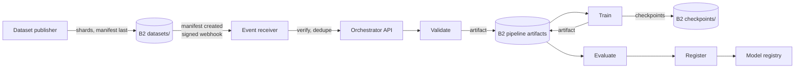

# Orchestrate training pipelines and retrain when new data lands

Evidence reviewed: 2026-10-15. ZenML B2 integration from source; Kubeflow Pipelines, Metaflow, Flyte, Kedro, Argo Workflows, Dagster, Prefect, and MLRun storage configuration from source review; B2 event notification documentation; signed-event handling tested in the [MLflow sample](../../applications/mlflow-b2-model-registry/README.md). This architecture is source-reviewed and has no dedicated sample. See [Evidence and validation scope](#evidence-and-validation-scope).

## Workload

A training workflow is a chain of steps: validate data, preprocess, train, evaluate, register. Orchestrators run the steps as containers or functions and pass each step's outputs to the next through an artifact store. When a new dataset version is published, the chain should run again without anyone starting it by hand. B2 is the artifact store, and its event notifications provide the trigger.

## Data flow

## Orchestrator connections

| Orchestrator | Artifact store on B2 | Trigger from a B2 event |
|---|---|---|
| ZenML | `b2` artifact store flavor, or the `s3` flavor with `client_kwargs.endpoint_url` | Receiver triggers a pipeline run through the ZenML server API |
| Kubeflow Pipelines | S3-compatible object store configuration with endpoint, region, and path-style addressing for the API server and launcher | Receiver creates a run through the KFP API |
| Metaflow | S3 datastore with `METAFLOW_DATASTORE_SYSROOT_S3=s3://<bucket>/metaflow` and `METAFLOW_S3_ENDPOINT_URL` | Receiver deploys or triggers a flow with the scheduler you run it on |
| Flyte | `storage.type: s3`, `storage.connection.endpoint`, access-key authentication | Receiver launches an execution through FlyteAdmin |
| Kedro | Catalog `credentials` with `client_kwargs.endpoint_url` passed to s3fs | Receiver runs `kedro run` in a job; Kedro has no built-in trigger API |
| Argo Workflows | S3 artifact repository with `endpoint`, `bucket`, `region`, and key secrets | Receiver submits a WorkflowTemplate; Argo Events can also consume webhooks |
| Dagster | dagster-aws `S3Resource` and S3 IO managers with `endpoint_url` | Receiver launches a job run through the Dagster GraphQL API, or a sensor polls for new manifests |
| Prefect | prefect-aws `S3Bucket` with `AwsClientParameters(endpoint_url=...)` | Receiver creates a flow run from a deployment through the Prefect API |
| MLRun | `s3` datastore with `AWS_ENDPOINT_URL_S3` or a `DatastoreProfileS3` with `endpoint_url` | Receiver runs the project workflow through the MLRun API |

Every orchestrator keeps its metadata in its own database. Only artifacts and checkpoints live on B2.

## Retraining trigger

1. Notification rule on the datasets bucket, prefix `datasets/`, event types `b2:ObjectCreated:Upload` and `b2:ObjectCreated:MultipartUpload` ([example](../../examples/event-notifications-retrain.json)).
2. The receiver verifies `X-Bz-Event-Notification-Signature`, persists the delivery, responds 200, and keeps only keys ending in `/manifest.json`. Work that fails after the acknowledgement is retried from the persisted copy, because B2 will not redeliver it.
3. It deduplicates on the manifest key and fingerprint, because delivery is at least once.
4. It calls the orchestrator with the dataset id and fingerprint as run parameters, so the pin travels with the run.

A generic fan-out receiver is available as the [B2 Event Broker](https://github.com/backblaze-b2-samples/b2-event-broker) sample. The [MLflow sample](../../applications/mlflow-b2-model-registry/README.md) shows signature verification, persistence before acknowledgement, retries, and idempotent processing in a small receiver.

## B2 zones

| Zone | Prefix | Lifecycle | Purpose |
|---|---|---|---|
| Datasets | `datasets/<dataset>/<version>/` | keep | Pipeline inputs and trigger source |
| Pipeline artifacts | `<orchestrator>/<pipeline>/<run>/` | expire intermediates after N days ([example](../../examples/lifecycle-staging.json)) | Step outputs |
| Checkpoints and models | See [checkpointing](../checkpoint-and-resume-training/architecture.md) | | |

Intermediate artifacts dominate object count. Expire them, and keep only registered models and pinned datasets long term.

## Security

| Role | Scope | Capabilities |
|---|---|---|
| pipeline-runner | pipeline artifact prefix | `listFiles`, `readFiles`, `writeFiles` |
| training step | datasets read, checkpoints write | Two keys, one per bucket |
| event-receiver | datasets `datasets/` | `listFiles`, `readFiles` |
| provisioning (admin) | account | Notification rules, lifecycle |

- The receiver triggers runs; it never writes datasets.
- Authenticate the receiver to the orchestrator API with its own token, and scope that token to running the retraining pipeline.

## Where B2 does not fit

- Orchestrator metadata stores, queues, and schedulers.
- Low-latency step-to-step handoff of tiny values: pass parameters, not objects.
- Event delivery guarantees beyond at least once: deduplicate in the receiver.

## Evidence and validation scope

Connection details come from orchestrator source and configuration review, and ZenML's B2 flavor from its source. Event verification and idempotent handling are tested in the MLflow sample. Deployment validation must cover the chosen orchestrator version, artifact passing between steps against the target region, receiver reachability, notification rule prefixes, and duplicate-event handling.
