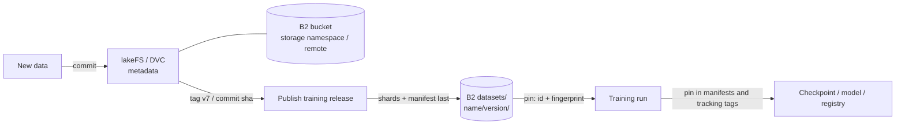

# Pin dataset versions for reproducible training runs

Evidence reviewed: 2026-10-15. lakeFS, DVC, and Pachyderm storage paths from source review; Hugging Face Datasets from documentation; fingerprint pinning exercised by the [PyTorch sample](../../applications/pytorch-b2-checkpointed-training/README.md) tests. This architecture is source-reviewed and has no dedicated sample. See [Evidence and validation scope](#evidence-and-validation-scope).

## Workload

Datasets keep changing: new data arrives, labels are fixed, and records are removed for rights or privacy reasons. Months later someone asks which data trained a model, or needs to retrain it exactly. Every run must therefore point to an immutable dataset version, and that version must still exist for as long as models trained on it are in use.

## Three ways to version on B2

| Approach | How versions work | Best for | Tradeoff |
|---|---|---|---|
| Immutable release prefixes | `datasets/<dataset>/<version>/` plus a manifest with a fingerprint, written last ([contract](../../docs/training-run-contract.md)) | Released, training-ready datasets; cross-team handoff | Unchanged files are copied into each version unless a manifest references a previous version |
| lakeFS | Branches, commits, and tags over a B2 storage namespace; unchanged objects are shared between commits | Frequently changing data lakes, isolated experiments on branches | Runs a lakeFS server and its metadata database |
| DVC | Content-addressed cache on a B2 remote; the version is the Git commit of `.dvc` files | Teams that version data next to code in Git | Version history lives in Git; large file counts need care |

They combine: lakeFS or DVC for working data, then publish a training-ready release prefix whose manifest records the source commit in `provenance.source_release`.

## Data flow

## Connections

| Tool | Configuration |
|---|---|
| lakeFS | `blockstore.type: s3`, `blockstore.s3.endpoint: https://s3.<region>.backblazeb2.com`, `blockstore.s3.region`, `blockstore.s3.force_path_style: true`, and a scoped key. Repository storage namespace `s3://<bucket>/<repo>`. Clients then read `s3://<repo>/<ref>/<path>` through the lakeFS S3 gateway or the lakeFS API. |
| DVC | `dvc remote add -d storage s3://<bucket>/dvc` then `dvc remote modify storage endpointurl https://s3.<region>.backblazeb2.com` and `region <region>`. Keys go in `.dvc/config.local` or environment variables, never in the committed config. |
| Hugging Face Datasets | `load_dataset(..., data_files="s3://<bucket>/datasets/<dataset>/<version>/*.parquet", storage_options={"key": ..., "secret": ..., "client_kwargs": {"endpoint_url": ...}})` |
| Pachyderm (candidate) | S3 object storage through gocloud.dev blob URLs with an explicit endpoint parameter (`src/internal/obj/bucket.go`). Confirm the deployment configuration and the project's maintenance status on a pinned release before relying on it. Pachyderm also records pipeline provenance, which complements the manifest pins here. |

Existing samples: [lakeFS on B2 quickstart](https://github.com/backblaze-b2-samples/lakefs-on-b2-quickstart) and the [lakeFS dataset-versioning notebook](https://github.com/backblaze-b2-samples/notebooks).

## What a pin contains

| Field | Example | Why |
|---|---|---|
| Dataset id | `synthetic-shapes@v1` | Human-readable reference |
| Fingerprint | SHA-256 over sorted `path:sha256` lines | Detects any change, including one hidden behind the same name |
| Source reference (optional) | lakeFS commit ID or DVC Git SHA | Lets you trace back to working data |

The training job resolves the pin at startup and stops if the fingerprint differs. The pin is copied into every checkpoint manifest, model manifest, and tracking tag ([contract](../../docs/training-run-contract.md)).

## Retention and deletion

- Keep a pinned version for as long as any model that depends on it is deployed or under audit. Object Lock in governance mode on release prefixes enforces this against accidental deletion.
- When data must be removed for rights or privacy reasons, publish a new version without it, retrain, and retire models trained on the old version. Then delete the old version with an administrative key that has `bypassGovernance`. Never edit a pinned version in place: that silently breaks every pin that refers to it.
- lakeFS garbage collection and DVC `gc` delete unreferenced objects. Run them with retention rules that protect tagged commits.

## Security

| Role | Scope | Capabilities |
|---|---|---|
| versioning-service (lakeFS server or DVC pusher) | dataset bucket | `listFiles`, `readFiles`, `writeFiles` (covers garbage collection by name, which hides files); add `deleteFiles` only if the tool deletes specific versions |
| release-publisher | `datasets/` | `listFiles`, `readFiles`, `writeFiles`, `writeFileRetentions` |
| training-reader | `datasets/<dataset>/` | `listFiles`, `readFiles` |

lakeFS keeps its metadata in its own database, which does not run on B2. Training jobs that read through the lakeFS gateway authenticate to lakeFS, not to B2.

## Where B2 does not fit

- lakeFS and DVC metadata stores: use their own databases or Git.
- In-place edits to a version: objects are immutable by design here.

## Evidence and validation scope

lakeFS and DVC connection details come from source review. Fingerprint pinning is tested in the PyTorch sample. Deployment validation must cover the chosen lakeFS or DVC version against the target region, garbage-collection retention rules, and Object Lock interaction with any tool that deletes objects.
