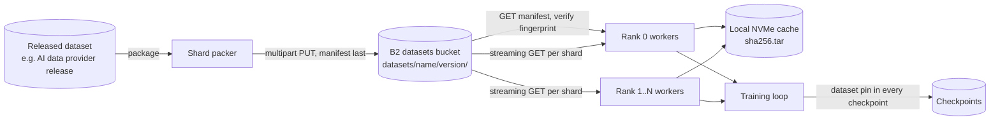
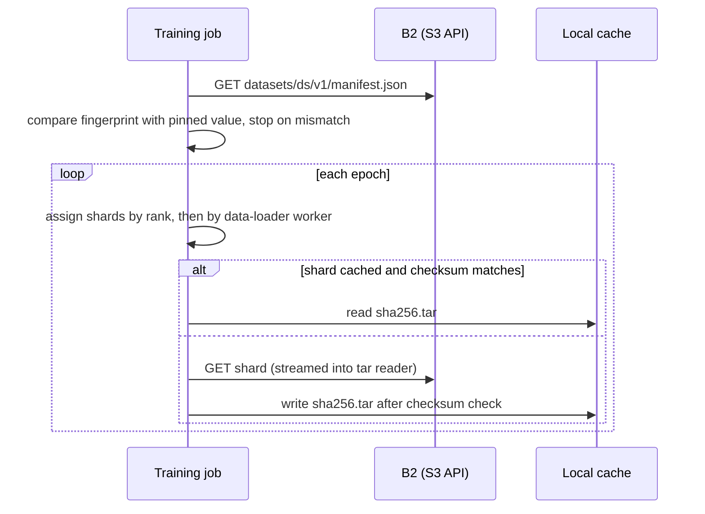

# Stream versioned training shards from B2 to GPU workers

Evidence reviewed: 2026-10-14. PyTorch, WebDataset, Ray, tensorflow-io, and Hugging Face Datasets storage paths from source and documentation review; B2 documentation; moto-backed tests in the [PyTorch sample](../../applications/pytorch-b2-checkpointed-training/README.md). See [Evidence and validation scope](#evidence-and-validation-scope).

## Workload

A training team turns a released dataset into training-ready shards and runs many epochs over it on one or more GPU nodes, often on rented or preemptible compute. B2 holds one durable copy of each dataset version. Workers stream shards directly from B2 instead of copying the whole dataset to every node first, and every run records exactly which version it read.

## Data flow

## B2 zones

| Zone | Bucket | Prefix | Versioning / lifecycle | Lock | Purpose |
|---|---|---|---|---|---|
| Datasets | `<org>-train-datasets` | `datasets/<dataset>/<version>/` | keep; versions are immutable by contract | optional governance | Training-ready shards and the shard manifest |
| Staging (optional) | `<org>-train-staging` | `packing/<job>/` | purge after 7 days ([example](../../examples/lifecycle-staging.json)) | no | Partial packing output before publication |

Checkpoints and models live in their own buckets; see [checkpoint and resume](../checkpoint-and-resume-training/architecture.md). Full key layout: [object-layout.md](../checkpoint-and-resume-training/object-layout.md).

## Shard design

- **Format:** WebDataset tar shards: every sample is a group of files sharing a key (`<key>.png`, `<key>.cls`, `<key>.json`). A tar reads sequentially, so one GET streams many samples and object-store request rate stays low. The [shared dataset](../../testdata/synthetic-shapes/README.md) uses this layout.
- **Size:** hundreds of megabytes to a few gigabytes per shard in production. Too small and request overhead and listing cost dominate; too large and shuffling granularity and retry cost suffer. The test dataset uses tiny shards only to stay small.
- **Count:** at least `world_size × workers_per_rank` shards per split, ideally many times that, so every data-loader worker gets work and shard-level shuffling has room.
- **Manifest:** the [shard manifest](../../schemas/shard-manifest.schema.json) lists every shard with size, SHA-256, and sample count, and a content fingerprint. Writing it last makes its presence the commit marker for the version.
- **Shuffling:** shuffle the shard order per epoch with a seed shared by all ranks, then shuffle samples inside a bounded buffer. That gives approximate global shuffling without random access.

## Boundaries

| Concern | Lives in | Why |
|---|---|---|
| Dataset shards and manifests | B2 | Durable, shared by every run and every node, versioned by prefix |
| Hot shards for repeated epochs | Local NVMe cache | Avoids re-reading the same immutable bytes every epoch |
| Decoded samples, prefetch buffers | Worker RAM | Latency-sensitive |
| Feature stores, lakehouse tables | Their own engines, which may use B2 underneath | Query semantics are not part of this workflow |
| Compute | Your GPUs or a compute partner | B2 stores; it does not compute |

## B2 capability map

| Capability | Used | Where |
|---|---|---|
| S3-compatible API | [x] | Packer, loaders (boto3, s3fs, pyarrow) |
| Scoped application keys | [x] | Packer writes `datasets/`; workers read only |
| Multipart upload | [x] | Large shards from the packer |
| Ranged GET | [ ] optional | Random access into large files; WebDataset reads whole shards sequentially |
| Presigned URLs | [ ] optional | Hand a single run read access without a key, for example to an external partner |
| Event notifications | [x] optional | Shard manifest created → start or queue training ([example](../../examples/event-notifications-retrain.json)) |
| Versions and lifecycle rules | [x] | Purge abandoned packing output |
| SSE-B2 | [x] | Default bucket encryption ([example](../../examples/sse.json)) |
| Object Lock | [ ] optional | Lock dataset versions that production models depend on |
| Included egress | [x] | Reads from your compute; check [pricing](https://www.backblaze.com/cloud-storage/pricing) for terms |
| Standard B2 | [x] | Default |
| B2 Overdrive | [ ] conditional | See below |
| Local cache | [x] conditional | Repeated epochs on the same nodes |

### Standard B2 vs Overdrive vs local cache

- **Standard B2:** default. Most training jobs are compute-bound once loaders prefetch enough shards in parallel. Measure GPU utilization and data-loader wait time before changing anything.
- **Local cache:** when the same nodes run several epochs, cache shards on local NVMe keyed by SHA-256. This is safe because dataset versions are immutable, and the checksum key means a stale cache entry can never be read as the wrong data. The [sample](../../applications/pytorch-b2-checkpointed-training/README.md) implements `--cache-dir`.
- **[B2 Overdrive](https://www.backblaze.com/cloud-storage/b2-overdrive):** consider it when sustained aggregate read throughput across many GPU nodes is the measured bottleneck and caching does not remove it, for example single-pass training over very large corpora. Overdrive is sales-engaged and is not exercised by the samples.

## Framework connections

| Framework | How it reads from B2 | Notes |
|---|---|---|
| PyTorch | `IterableDataset` that opens each shard with boto3 `get_object` and reads it as a stream; or fsspec `s3://` paths with `client_kwargs={"endpoint_url": ...}` | Split shards by rank and by `torch.utils.data.get_worker_info()` |
| WebDataset | `webdataset.WebDataset` over fsspec URLs, or a `pipe:` command that runs an S3 client configured with the B2 endpoint | Same shard format as the sample |
| Ray Data / Ray Train | `pyarrow.fs.S3FileSystem(endpoint_override="https://s3.<region>.backblazeb2.com", region=...)` passed as the filesystem to Ray Data readers | Ray handles worker parallelism |
| TensorFlow | `tf.data` over `s3://` paths through tensorflow-io with `S3_ENDPOINT` set to the B2 endpoint | Use TFRecord shards |
| Hugging Face Datasets | `storage_options={"key": ..., "secret": ..., "client_kwargs": {"endpoint_url": ...}}` | Good for text corpora in Parquet or JSONL |

Derive the endpoint from the bucket region and never hardcode it. Clients that default to virtual-hosted addressing work with B2; path-style is also accepted.

## Security, retention, provenance, access

| Role | Bucket / prefix | Capabilities |
|---|---|---|
| dataset-publisher | datasets `datasets/` | `listFiles`, `readFiles`, `writeFiles` |
| training-reader | datasets `datasets/<dataset>/` | `listFiles`, `readFiles` |
| provisioning (admin) | account | Bucket settings, lifecycle, notifications; not used at runtime |

- Pin each run to `<dataset>@<version>` and the manifest fingerprint. A job that sees a different fingerprint must stop: the version was overwritten, which the publishing contract forbids.
- Training workers never get write access to `datasets/`.
- Record the pin in every [checkpoint and model manifest](../../docs/training-run-contract.md).
- Keys live in a secret store or a Kubernetes Secret ([template](../../infrastructure/kubernetes/README.md)), never in images.

## Where B2 does not fit

- POSIX-only loaders that need random seeks into millions of small files: repackage into shards first, or use a cache or a filesystem layer in front of B2.
- Sub-millisecond random access to individual samples: keep that working set in RAM or local NVMe.
- Running the loaders or decoding: compute lives elsewhere.

## Integrations

| Tool | Role | Connection | Evidence |
|---|---|---|---|
| PyTorch | Data loading | boto3 or fsspec with the B2 endpoint | Source review; sample tests 2026-10-14 |
| WebDataset | Shard format and loader | fsspec URLs or `pipe:` S3 client | Format used by the shared dataset |
| Ray Data / Train | Parallel loading | `pyarrow.fs.S3FileSystem(endpoint_override=...)` | Source review 2026-05 |
| tensorflow-io | `tf.data` input | `S3_ENDPOINT` | Source review 2026-05 |
| Hugging Face Datasets | Loading and preprocessing | fsspec `storage_options` | Documentation 2026-10-14 |

## Sample application

[applications/pytorch-b2-checkpointed-training](../../applications/pytorch-b2-checkpointed-training/README.md): publishes the shared shards with the manifest last, verifies the pinned fingerprint, streams shards into a PyTorch `IterableDataset` split by rank and worker, and caches shards locally by checksum.

## Evidence and validation scope

Streaming, fingerprint pinning, shard assignment, and caching are covered by moto-backed tests. Framework connection details come from source and documentation review. Deployment validation must cover real key scoping, measured per-node and aggregate throughput, GPU utilization with the chosen shard size and prefetch depth, and cache behavior on the target nodes.
