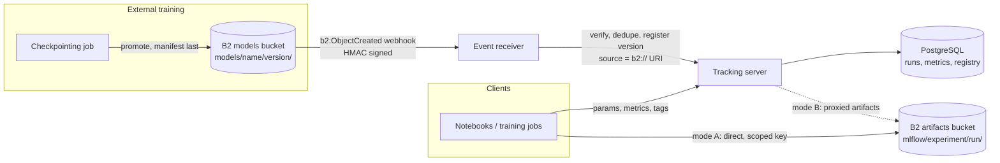

# Track experiments and register models with a B2 artifact store

Evidence reviewed: 2026-10-14. The MLflow B2 artifact repository from source (`mlflow/store/artifact/b2_artifact_repo.py`), W&B and ClearML storage handlers from source and documentation review, B2 event notification documentation, and moto-backed tests in the [MLflow sample](../../applications/mlflow-b2-model-registry/README.md). See [Evidence and validation scope](#evidence-and-validation-scope).

## Workload

Teams run many experiments, compare metrics, keep the artifacts of promising runs, and promote a few models to production. A tracking system splits into two stores: a small transactional database for runs, metrics, and the registry, and a large artifact store for model files, plots, evaluation outputs, and dataset snapshots. B2 is the artifact store. Some models are trained outside the tracking client, for example by a checkpointing job. Those get registered when their model manifest lands in B2.

## Data flow

## Artifact access modes

| Mode | Server flag | Who holds B2 keys | Bandwidth path | Choose when |
|---|---|---|---|---|
| A. Direct | `--default-artifact-root b2://<bucket>@s3.<region>.backblazeb2.com/mlflow` with `--no-serve-artifacts` | Every client, scoped to the artifact prefix | Client ↔ B2 | Trusted training infrastructure, large models, high throughput |
| B. Proxied | `--artifacts-destination b2://...` with `--serve-artifacts` | Only the tracking server | Client ↔ server ↔ B2 | Many users, notebooks, or third parties that must not hold storage keys |

Mode B is simpler to secure but turns the tracking server into a bandwidth bottleneck for large models. You can run both: proxied for people, direct for training jobs. Deployment template: [infrastructure/mlflow](../../infrastructure/mlflow/README.md).

## MLflow connection (verified against MLflow source)

MLflow registers a `b2` artifact scheme backed by `B2ArtifactRepository`, a subclass of the optimized S3 repository:

| Element | Value |
|---|---|
| URI | `b2://<bucket>@s3.<region>.backblazeb2.com/<path>` |
| Endpoint | `https://<host>` taken from the URI |
| Region | Parsed from the host |
| Addressing | Path-style |
| Credentials | Standard boto3 chain: `AWS_ACCESS_KEY_ID` and `AWS_SECRET_ACCESS_KEY` set to a B2 application key |
| User agent | Adds `b2ai-mlflow` |

The plain S3 path also works: `s3://<bucket>/<path>` with `MLFLOW_S3_ENDPOINT_URL=https://s3.<region>.backblazeb2.com`. Prefer `b2://`, because the endpoint travels with the URI, so different experiments can use buckets in different regions.

## Other trackers

| Tool | How artifacts reach B2 | Notes |
|---|---|---|
| Weights & Biases | Reference artifacts on `s3://` URIs; the S3 handler reads `AWS_S3_ENDPOINT_URL` | W&B stores the reference and checksums; the bytes stay in your bucket |
| ClearML | `output_uri` on the B2 endpoint with host-specific credentials in `clearml.conf` | ClearML documents B2 among non-AWS S3 endpoints |

## Event-driven registration

1. A training job promotes a model and writes `models/<model>/<version>/manifest.json` last ([schema](../../schemas/model-manifest.schema.json)).
2. A B2 event notification rule on `models/` sends `b2:ObjectCreated:*` to the receiver ([example](../../examples/event-notifications.json)).
3. The receiver verifies `X-Bz-Event-Notification-Signature` (`v1=` + HMAC-SHA256 of the raw body), writes the delivery to durable storage, and only then responds 200. B2 retries a delivery that is not acknowledged in time, but it cannot see failures that happen after the 200. So an accepted event must survive a crash, and the worker must retry temporary failures and keep permanently failed events for inspection.
4. A worker reads the manifest, validates it against the schema, recomputes its fingerprint, checks each object's stored SHA-256, and creates a registry version whose source is the `b2://` URI of the model prefix. It tags the version with the dataset pin, source run and step, and manifest fingerprint.
5. Deliveries are at least once, so the worker skips a manifest fingerprint that is already registered.

Filter on the manifest key, not on every object: a model with many files would otherwise trigger one registration attempt per file.

## B2 zones

| Zone | Bucket | Prefix | Lifecycle | Lock | Purpose |
|---|---|---|---|---|---|
| Artifacts | `<org>-mlflow-artifacts` | `mlflow/<experiment>/<run>/` | Optional expiry for abandoned experiments | no | Run artifacts and logged models |
| Models | `<org>-train-models` | `models/<model>/<version>/` | none | governance | Promoted models from external training |

## Boundaries

| Concern | Lives in | Why |
|---|---|---|
| Artifacts and model files | B2 | Large, durable, shared across teams and regions |
| Runs, metrics, params, registry | PostgreSQL or another SQL backend on block storage | Transactional, queried constantly |
| Tracking server | Container or VM | Stateless apart from its database |
| Event receiver | Small HTTPS service | Must answer within B2's webhook timeout |
| Serving | See the model inference category | Outside this workflow |

## B2 capability map

| Capability | Used | Where |
|---|---|---|
| S3-compatible API | [x] | MLflow, W&B, ClearML clients |
| Scoped application keys | [x] | Client, server, and receiver roles |
| Multipart upload | [x] | Large logged models |
| Event notifications | [x] | Model manifest created → register |
| Versions and lifecycle rules | [x] optional | Expire abandoned experiment artifacts |
| SSE-B2 | [x] | Default encryption |
| Object Lock | [x] optional | Artifacts of production model versions |
| Presigned URLs | [ ] optional | Share a single artifact without a key |
| Cloud Replication | [ ] optional | Models bucket to DR |

## Security, retention, provenance, access

| Role | Bucket / prefix | Capabilities |
|---|---|---|
| tracking-client (mode A) | artifacts `mlflow/` | `listFiles`, `readFiles`, `writeFiles` |
| tracking-server (mode B) | artifacts `mlflow/` | `listFiles`, `readFiles`, `writeFiles`, `deleteFiles` for garbage collection |
| event-receiver | models `models/` | `listFiles`, `readFiles` |
| provisioning (admin) | account | Bucket settings and `writeBucketNotifications` |

- The event receiver only reads. It writes to the registry through the tracking API, never to B2.
- Store the webhook signing secret like a key, and rotate it with the notification rule.
- The tracking database holds the lineage tags. Back it up, for example by dumping it to B2 as objects. It does not run on B2.

## Where B2 does not fit

- The tracking database and the registry: transactional, so use a SQL database.
- Metric streams written every step: those go to the tracking database, not to objects.
- Serving models directly from the registry under load: deploy to an inference platform.

## Integrations

| Tool | Role | Connection | Evidence |
|---|---|---|---|
| MLflow | Tracking, artifacts, registry | Native `b2://` URIs | Source 2026-10-14; sample tests |
| Weights & Biases | Tracking with reference artifacts | `AWS_S3_ENDPOINT_URL` | Source review 2026-05 |
| ClearML | Tracking and model repository | `output_uri` plus `clearml.conf` host credentials | Documentation 2026-10-14 |

## Sample application

[applications/mlflow-b2-model-registry](../../applications/mlflow-b2-model-registry/README.md): trains a tiny classifier on the shared dataset, logs to MLflow with a `b2://` artifact root, registers and promotes the model by alias, and registers externally promoted models from signed B2 events.

## Evidence and validation scope

MLflow connection details come from MLflow source. Logging, registration, and event handling are covered by moto-backed tests. Deployment validation must cover the chosen MLflow version and artifact mode, real key scoping, webhook reachability and signature handling, notification rule prefixes, and large-model upload throughput through the chosen path.
