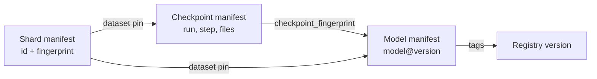

# Training run contract

Three manifests connect a model back to the exact data that trained it. Each one is written last under its prefix, so its presence marks that prefix as complete. B2 has no multi-object transactions; a prefix without its manifest is incomplete and must be ignored.

## Manifests

| Manifest | Location | Schema | Written by | Proves |
|---|---|---|---|---|
| Shard manifest | `datasets/<dataset>/<version>/manifest.json` | [shard-manifest.schema.json](../schemas/shard-manifest.schema.json) | Dataset publisher | Which shards make up a dataset version, with per-shard SHA-256, sample counts, splits, license, and provenance |
| Checkpoint manifest | `checkpoints/<run>/step-<step>/manifest.json` | [checkpoint-manifest.schema.json](../schemas/checkpoint-manifest.schema.json) | Training coordinator, after every rank has uploaded | Which files make up a resumable checkpoint, at which step, trained on which dataset version |
| Model manifest | `models/<model>/<version>/manifest.json` | [model-manifest.schema.json](../schemas/model-manifest.schema.json) | Promoter | Which checkpoint a promoted model came from, its dataset pin, metrics, files, and retention mode |

Examples: [shard manifest](../testdata/synthetic-shapes/manifest.json), [checkpoint manifest](../manifests/checkpoint-manifest.example.json), [model manifest](../manifests/model-manifest.example.json).

## Lineage

- **Dataset pin:** `{"id": "<dataset>@<version>", "fingerprint": "<sha256>"}`. It is copied from the shard manifest into every checkpoint and model manifest and into tracking tags (`dataset.id`, `dataset.fingerprint`).
- **Fingerprint:** SHA-256 over the sorted lines `path:sha256` for every file in the prefix. Timestamps and request-specific values are excluded, so identical content always produces the same fingerprint.
- **Checkpoint fingerprint:** the checkpoint manifest's fingerprint, recorded in the model manifest's `source`.

## Rules

1. Upload data objects first, verify remote sizes and stored checksums, then write the manifest.
2. Never overwrite a version. Rerunning identical content is a no-op; different content at an existing key is a collision. Publish a new version instead.
3. Consumers recompute every fingerprint from the listed files instead of trusting the stored value. Training stops when the recomputed shard manifest fingerprint differs from the stored one or from the pinned value.
4. Resume uses the highest step whose manifest exists and whose files match their checksums.
5. Promotion verifies the source bytes against the checkpoint manifest, then copies them into the model prefix. It does not reference checkpoints, so pruning can never delete a model.
6. Store each object's SHA-256 in user metadata, and keep the rest of the metadata small (Object Lock buckets have a lower per-version metadata limit).
7. Schema versions use semantic versioning. Consumers reject unsupported major versions.
8. Manifest paths are relative POSIX paths without empty, `.` or `..` segments, and readers also check that resolved local paths stay inside their target folder.

## Relationship to the AI data provider release contract

An AI data provider release ([sibling repository](https://github.com/backblaze-b2-samples/b2-ai-data-provider-reference-architectures)) is a customer-facing dataset with a dataset card, Croissant metadata, and delivery manifests. A training team packages such a release into shards and records the upstream release id in the shard manifest's `provenance.source_release`. The two contracts meet there.

## Security

Manifests contain no credentials. They can reveal dataset names, class lists, and metrics, so keep them as private as the data they describe. Presigned URLs are never stored in any manifest.
